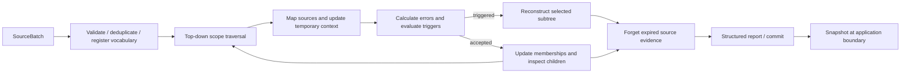

# Implementation map

The hierarchy is **paper → [algorithm.md](algorithm.md) → this map → Rust**.
[State invariants](state.md) define the consistency requirements.

## Canonical flow

`SecaEngine::build_baseline_tree` constructs the initial model once.
`SecaEngine::process_batch` clones the model, runs the following operations on the
candidate, and replaces the original only after every operation succeeds:

The traversal decides against state 0 vocabulary. Accepted scopes apply pending
memberships before child traversal and merge them afterward. Triggered scopes
record incoming provenance and ancestor context and stop descending. Once
traversal finishes, reconstruction replaces those disjoint targets. The incoming
batch is retained before reconstruction so later snapshots can resume fully.
Forgetting runs after reconstruction, as specified by the lifecycle.

## Source map

Paths below are relative to `crates/realtime-seca-core/src`.

| Module | Responsibility |
|---|---|
| `engine/mod.rs` | Engine ownership, configuration validation, transactional orchestration |
| `engine/baseline.rs` | Initial batch conversion and HKT construction |
| `engine/input.rs` | Sequence validation, deduplication, vocabulary admission, payload retention |
| `engine/sources.rs` | Stable source IDs and batch identity registration |
| `engine/scope_mapping.rs` | Immutable scope snapshots and incoming node assignment |
| `engine/context.rs` | Candidate strength admission, incoming word memberships, beta admission, membership mutation |
| `engine/evidence.rs` | Retained source word sets, parent-scope frequencies, ancestor context |
| `engine/metrics.rs` | Strength, eligibility, importance, and the three error calculations |
| `engine/trigger.rs` | Top-down traversal, threshold evaluation, selective reconstruction targets |
| `engine/rebuild.rs` | Scoped reconstruction datasets, ancestor propagation, subtree replacement and ID remapping |
| `engine/forgetting.rs` | Gamma cutoff and removal from every source index and membership |
| `engine/snapshotting.rs` | Full snapshots, restoration, and tree export |
| `engine/validation.rs` | Restore-time topology, membership, identity, and allocator checks |
| `engine/diagnostics.rs` | Observations on final topology for the existing tree viewer |
| `engine/batch_stats.rs` | Document-frequency counts for the retained public batch summary |
| `tree/hkt_builder.rs`, `tree/models.rs` | Recursive CA construction and hierarchy types |
| `types.rs`, `config.rs`, `error.rs` | Batch/report/snapshot contracts, parameters, errors |

Stage modules use ordinary methods on the engine; there is no pluggable policy or
pipeline framework. Mapping yields `MappedHktScopeState`; context builds
`HktUpdateStage`; metrics return per-word measurements; traversal yields a
`RecursiveTriggerPlan`. These objects live only for the current operation. Retained source-word sets are
computed once per traversal and passed explicitly to context and measurements.
The builder consumes `SourceWordRecord` rows and returns `HktBuildOutput`.

## Mutation boundaries

Baseline installs the initial topology. Input/source registration owns vocabulary
and source identity changes. Context commits accepted scope memberships.
Reconstruction removes the target and all descendants from both topology maps,
remaps fresh IDs, and attaches the replacement to the same parent node. Allocator
counters survive deletion, so IDs are never recycled. Unaffected scopes survive.
Forgetting edits memberships and source indexes together, retaining learned topology.

`hkts_by_id` owns ordered nodes; `nodes_by_id` mirrors nodes for parent lookup.
Context, reconstruction, and forgetting synchronize both representations within
one candidate transaction. Restoration validates their equality. This explicit
cache remains because parent-scope lookup and ancestor propagation consume it.

## Infrastructure and persistence

The core takes tokenized batches and returns Rust data. It performs no filesystem,
CSV, HTTP, or RiskLive ingestion work. CLI `main.rs` dispatches to `commands.rs`,
`timeline.rs`, `ingestion.rs`, `presentation.rs`, `server.rs`, and `update.rs`.
The two timeline commands retain their distinct consumers: chunking one input and
preserving already grouped input batches. Both invoke the same selective engine.
Newsmap's configuration writer exposes only supported parameters.

`update.rs` loads schema-4 state, checks configuration equality, runs one batch,
writes a tree export, then fsyncs and atomically renames the resumable snapshot.
Tree exports cannot restore the engine. The state rename is the commit point;
report/tree writes are not a multi-file atomic transaction.

Final-topology observations deliberately remain separate from trigger decisions:
the viewer needs values for newly introduced scopes, which were not independently
inspected during the update. The observation sweep uses a private view and cannot
mutate model decisions. It is a current presentation consumer, not a second update
strategy. Its additional clone and traversal are a remaining performance cost.

Tests under `engine/tests/` cover behavior by stage with common fixtures.
`tests/seca_light_stream.rs` exercises persistence, sibling preservation,
forgetting, restart equivalence, duplicates, empty updates, and failure isolation.
